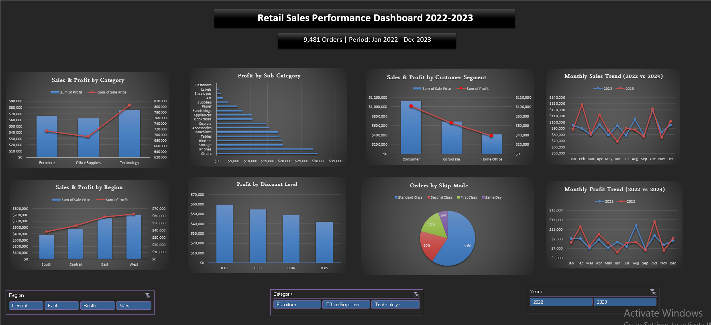

## Retail Sales Performance Dashboard (Excel)

An end-to-end sales analysis built in Excel: from a raw, messy orders file to a cleaned dataset, PivotTable analysis, and a dashboard that answers practical business questions.

## Project Overview

Goal: understand what drives sales and profit for a US retail company, and where discounts and customer mix help or hurt.

- Period: Jan 2022 – Dec 2023
- Orders analyzed: 9,481 (from 9,994 raw records)
- Tools: Excel, Power Query, PivotTables, PivotCharts, Slicers

## Business Questions

1. Which categories, sub-categories, and regions are the most profitable?
2. How do sales and profit change over time? Is there seasonality?
3. How do discounts affect profit?
4. Who are the customers, and how do they ship their orders?

## Data

- Source: [Retail Orders dataset on Kaggle](https://www.kaggle.com/datasets/ankitbansal06/retail-orders) (`orders.csv`)
- Size: 9,994 rows × 16 columns (order date, ship mode, segment, location, category, sub-category, cost price, list price, quantity, discount percent)

## Data Cleaning (Power Query)

| Issue | Action |
|---|---|
| 507 rows with cost price and list price equal to 0 | Removed. No pricing information, so profit cannot be calculated |
| Discount stored as whole numbers (e.g. 5) | Divided by 100 to get a proper percentage |
| Ship Mode contained null, Not Available, unknown | Standardized into one value, then excluded (6 rows, under 0.1% of the data) |
| Other columns | Checked for duplicates, inconsistent labels, and data types. Postal Code kept as text |

Calculated columns:
- Sale Price = List Price × (1 − Discount)
- Profit = Sale Price − Cost Price
- Profit Margin % = Profit / Sale Price

## Dashboard Contents

- Sales & profit by category
- Profit by sub-category
- Sales & profit by region
- Monthly sales trend (2022 vs 2023)
- Monthly profit trend (2022 vs 2023)
- Profit by discount level
- Sales & profit by customer segment
- Orders by ship mode
- Slicers: Region, Category, Year

## Key Findings

1. Technology leads on every core measure: sales (~$806K) and profit (~$76K). Profit margin (total profit ÷ total sales) is similar across categories, at roughly 9–9.5%.
2. Chairs is the most profitable sub-category (~$29.8K), slightly ahead of Phones (~$28.2K) even though Phones has slightly higher sales.
3. Fasteners, Labels, and Envelopes earn the least profit, but their sales are small, so the financial impact is limited.
4. West is the strongest region (~$697K sales, ~$62K profit). South is the weakest, with about 54% of West's sales.
5. Sales show no strong recurring seasonality, except October, which is about 30% above the monthly average in both years.
6. October's strength is not driven by discounts. Its average discount is in line with other months.
7. Discounts erode profit without lifting sales. From a 2% to a 5% discount, profit falls about 29% (~$59K to ~$42K) while sales stay roughly flat.
8. Consumer accounts for about 50% of sales and profit. Profit margin is similar across segments (~9–9.6%), so the gap comes from volume, not efficiency.
9. Standard Class is the dominant shipping mode (~59% of orders).

Additional observation: about 42% of order lines have negative profit after discount, because in many products the cost price equals the list price. These rows were kept, since they reflect the pricing reality and support the discount finding.

## Notes & Limitations

- Sales and profit are calculated per order line at unit price. The Quantity column is not applied, so totals are not total revenue. Rankings and relationships were checked with Quantity applied and stay the same, but dollar amounts would be roughly five times larger.
- The findings describe relationships only. For example, the data does not explain why October is higher.

## Repository Contents

| File | Description |
|---|---|
| Retail_Sales_Performance.xlsx | Final workbook: Dashboard, Key Findings, Pivot Tables, Cleaned Data |
| orders.csv | Original raw data |
| Dashboard.png | Dashboard screenshot |
